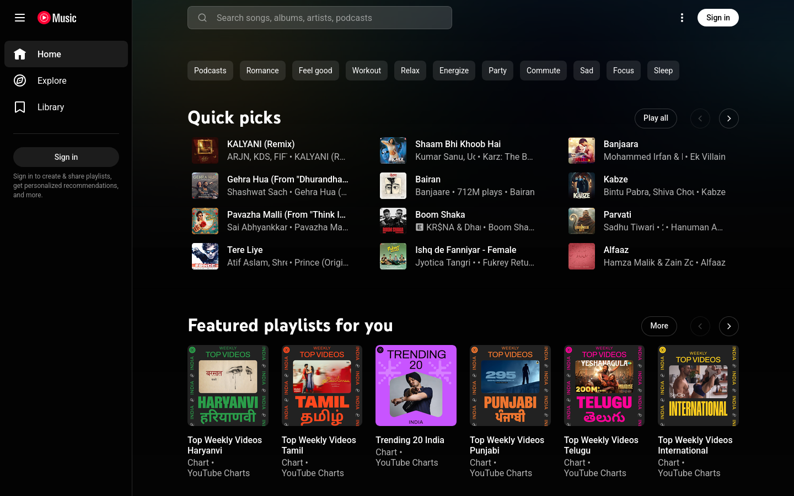
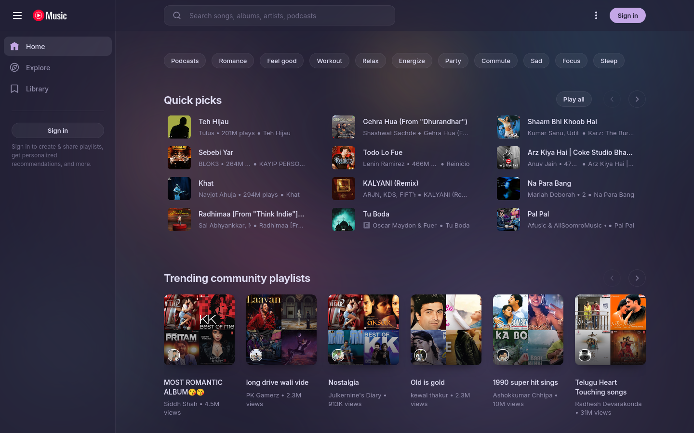
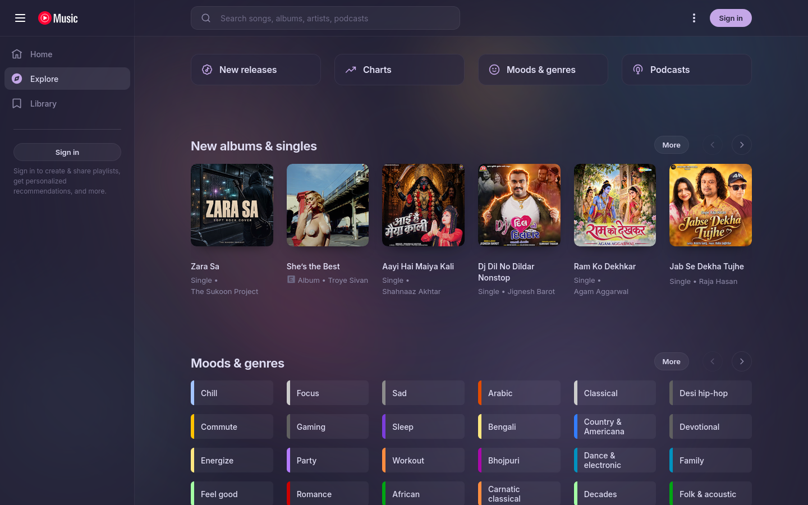
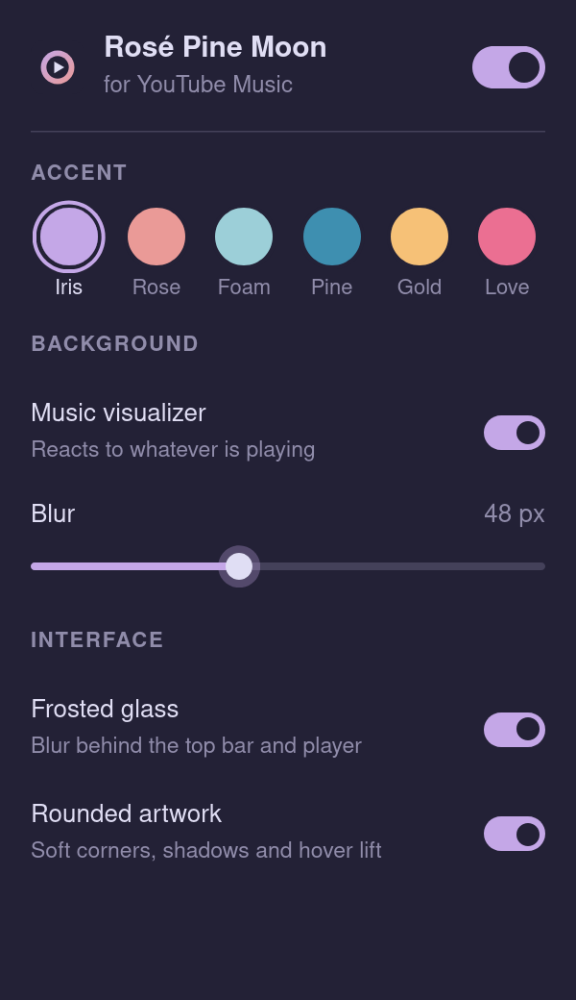

# YouTube Music — Rosé Pine Moon

A Firefox extension that reskins [YouTube Music](https://music.youtube.com) with the
[Rosé Pine Moon](https://rosepinetheme.com/palette) palette and a calmer, more minimal
layout, with a blurred music visualizer behind the whole page.

| Stock | Rosé Pine Moon |
| --- | --- |
|  |  |



## Features

- **Background visualizer.** Soft orbs and a spectrum in Rosé Pine colours react to
  whatever is playing, under an adjustable blur (0–120 px). It pauses while the tab is
  hidden and shows a still frame if you prefer reduced motion.
- **Cleaner layout.** Bundled Inter typeface, one consistent type scale, 32 px pill
  buttons and chips, quieter section headers, tidier track rows with tabular durations,
  glass panels instead of solid black boxes.
- **Clear hierarchy.** The accent colour is reserved for primary actions (play,
  subscribe, the current track); everything else stays neutral.
- **Six accents** from the toolbar popup: Iris, Rose, Foam, Pine, Gold, Love.
- **Toggles** for the visualizer, frosted glass and rounded artwork.
- Applied at `document_start`, so the stock theme doesn't flash on load.
- No tracking, no network requests, one permission (`storage`).



## Install

### From source (temporary)

1. Clone this repo.
2. Open `about:debugging#/runtime/this-firefox` in Firefox.
3. Click **Load Temporary Add-on…** and select `manifest.json`.

Temporary add-ons are removed when Firefox restarts.

### Development

The project uses Mozilla's [`web-ext`](https://github.com/mozilla/web-ext) tool.

```sh
npm install
npm start        # launches a clean Firefox profile with the extension loaded and live-reloads on save
npm run lint     # validates the manifest and code against addons.mozilla.org rules
npm run build    # packages the extension into web-ext-artifacts/
```

Requires Firefox 142 or newer.

## How it works

| File | Role |
| --- | --- |
| `src/theme.css` | Injected by the manifest. Remaps YouTube Music's own design tokens (`--ytmusic-*`, `--yt-spec-*`, Polymer `--paper-*`) and restyles components. Every rule is scoped to `html[data-rpm-accent]`, so the theme switches off instantly. |
| `src/content.js` | Reads your settings from `storage` and mirrors them onto `<html>` as `data-rpm-*` attributes and the `--rpm-blur` variable. |
| `src/visualizer.js` | Runs in the page's own world so Web Audio can read the `<video>` element. Draws to a low-resolution canvas fixed behind the app; CSS applies the blur. It only connects to the audio once the audio context is running, so playback is never silenced. |
| `src/popup/` | The settings popup. |

YouTube Music changes its markup from time to time. If something looks off, open an
issue with a screenshot and the page it's on.

## Credits

Colours from [Rosé Pine](https://rosepinetheme.com). Typeface:
[Inter](https://rsms.me/inter/) (SIL Open Font License, see `fonts/OFL.txt`).
Not affiliated with YouTube or Google.

## License

[MIT](LICENSE)
